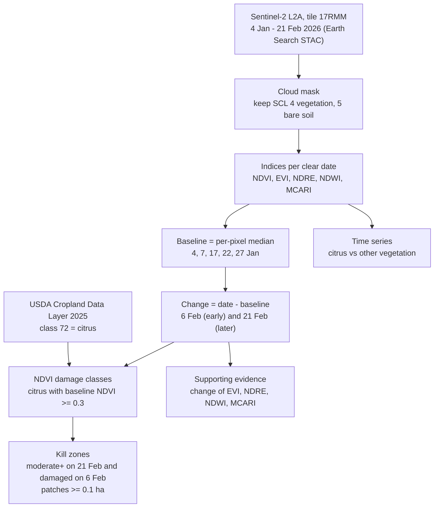
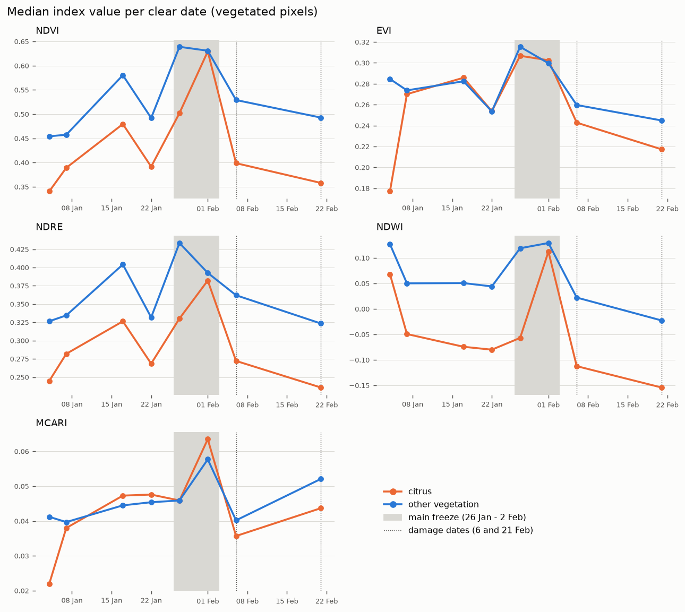

# Citrus freeze damage from Sentinel-2 – Lake County, Florida (Jan–Feb 2026)

A multi-day freeze hit central Florida from 26 January to 2 February 2026. This
repository maps the damage to citrus groves around Clermont (Lake County) with
Sentinel-2 imagery, by comparing vegetation indices after the freeze with a
January baseline. **NDVI change is the damage measure**; four other indices
(EVI, NDRE, NDWI, MCARI) are used as supporting evidence.

One command runs everything: search, download, cloud masking, indices, damage
classes, kill zones, tables and figures.

## Method



| NDVI change vs baseline | Damage class |
|---|---|
| >= -0.10 | none |
| -0.10 to -0.20 | mild |
| -0.20 to -0.30 | moderate |
| < -0.30 | severe |

The -0.10 threshold sits above normal date-to-date variation between two pre-freeze dates.

| Index | Formula (Sentinel-2 bands) | Sensitive to |
|---|---|---|
| NDVI | (B8 - B4) / (B8 + B4) | greenness |
| EVI | 2.5 (B8 - B4) / (B8 + 6 B4 - 7.5 B2 + 1) | greenness, less saturation |
| NDRE | (B8A - B5) / (B8A + B5) | chlorophyll (red edge) |
| NDWI (Gao) | (B8A - B11) / (B8A + B11) | leaf water content |
| MCARI | ((B5 - B4) - 0.2 (B5 - B3)) x (B5 / B4) | chlorophyll absorption |

## Results (10 m)

| | |
|---|---|
| Citrus in the area (CDL 2025) | 313.5 ha |
| Citrus assessed (vegetated, cloud-free baseline) | 217.0 ha |
| Damaged citrus (mild or worse), 6 Feb | **12.8%** |
| Damaged citrus (mild or worse), 21 Feb | **43.0%** |
| Moderate or worse, 6 Feb / 21 Feb | 0.5% / 3.9% |
| Severe, 6 Feb / 21 Feb | 0.01 ha / 0.4 ha |
| Kill zones | 6 zones, 6.1 ha |

Damage is mostly mild, and it grew strongly between 6 and 21 February:
freeze-injured leaves often stay green for days to weeks before they dry out
and drop. All six kill zones lie within about 2 km of each other in one grove area
(around 28.43 N, 81.86 W).


### How much each index changed for citrus

Median change of citrus pixels vs the baseline. "Change / noise" divides the
21 Feb change by the normal date-to-date variation of that index (robust SD of
the 17 Jan → 27 Jan difference), so the indices can be compared with each other.

| Index | Baseline (median) | Change 6 Feb | Change 21 Feb | Change / noise, 21 Feb |
|---|---|---|---|---|
| **NDVI** | 0.458 | -0.046 | -0.090 | **-3.7** |
| EVI | 0.282 | -0.036 | -0.061 | -2.9 |
| NDRE | 0.310 | -0.034 | -0.073 | -2.6 |
| NDWI | -0.068 | -0.036 | -0.079 | -3.0 |
| MCARI | 0.045 | -0.008 | +0.001 | 0.1 |

NDVI, EVI, NDRE and NDWI all fall, and all fall further by 21 February: the
canopy lost greenness, chlorophyll and leaf water, which is what freeze injury
looks like. NDVI gives the clearest signal relative to its noise. MCARI shows
no clear response.




Other figures in [`figures/`](figures): a map of each index on the baseline,
6 Feb and 21 Feb (`map_*.png`) and the change of each index (`change_*.png`).

## How to run

```bash
python -m venv .venv && source .venv/bin/activate
pip install -r requirements.txt

python run.py --test   # quick 60 m run (~1-2 min, small download)
python run.py          # full 10 m run (~1.5 GB download, ~4 GB RAM)
```

All settings (area, dates, thresholds, indices, colours) are in `config.yaml`.
Downloads are cached per band and date in `data/cache/`, so an interrupted run
resumes where it stopped. Results: figures in `figures/`; GeoTIFFs, kill-zone
polygons (GeoPackage) and CSV tables in `outputs/10m/`.

| File | What it does |
|---|---|
| `run.py` | runs all steps in order |
| `src/data.py` | STAC search, cached download, reflectance, cloud mask |
| `src/indices.py` | the five indices |
| `src/damage.py` | baseline, change, damage classes, citrus mask, kill zones |
| `src/plots.py` | all figures |

## Data sources

- **Sentinel-2 L2A** surface reflectance (Copernicus / ESA), as Cloud-Optimised
  GeoTIFFs from the [Earth Search STAC catalogue](https://earth-search.aws.element84.com/v1)
  (Element 84, AWS Open Data).
- **USDA NASS Cropland Data Layer 2025** (class 72 citrus), via the
  [CropScape](https://nassgeodata.gmu.edu/CropScape/) API.

## Limitations

- **Clouds and cirrus.** Only 6 Feb and 21 Feb are mostly clear. Many pixels have
  only one or two clear baseline dates, and 9% of the mapped citrus has none.
- **Time series** medians use whichever pixels are clear on each date, so dates
  with little clear area (4 Jan, 1 Feb) can differ for that reason alone.
- **21 Feb is three weeks after the freeze.** Damaged canopy is not the same as dead
  trees; a spring image (new flush) is needed to separate the two.
- **Baseline choice.** In a test with other baseline dates the damage figures moved by up
  to about 3 percentage points. 27 Jan (a baseline and noise date) is the morning after
  the first freeze night, and some damage from storm Ezra
  (30 Dec – 1 Jan) may already be in the baseline.
- **Citrus mask.** The CDL is a modelled map: some groves are missed or mislabelled,
  and 68 ha of mapped citrus has a baseline NDVI below 0.3 (young, reset or
  abandoned groves) and is not assessed.
- **BOA offset.** Earth Search's offset flag is not always correct, so the
  reflectance offset is decided from the data for each scene.
