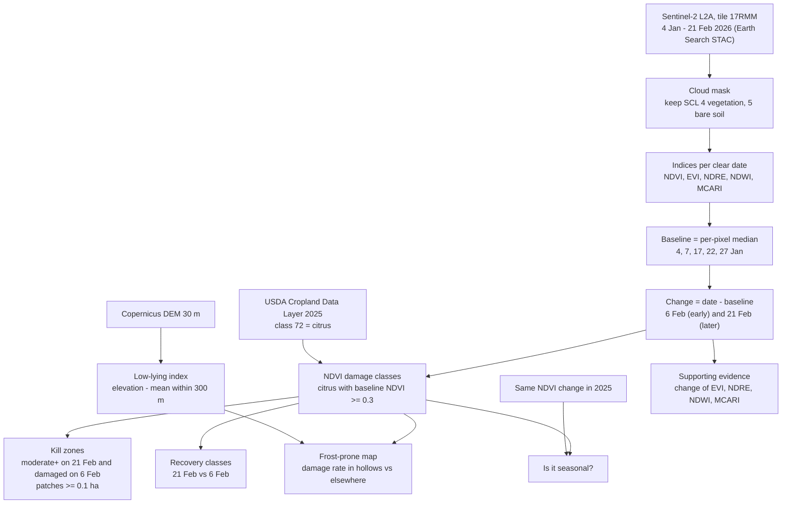
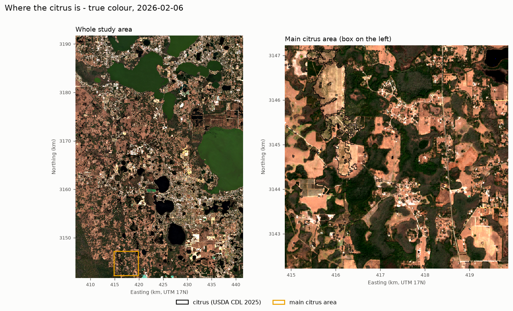
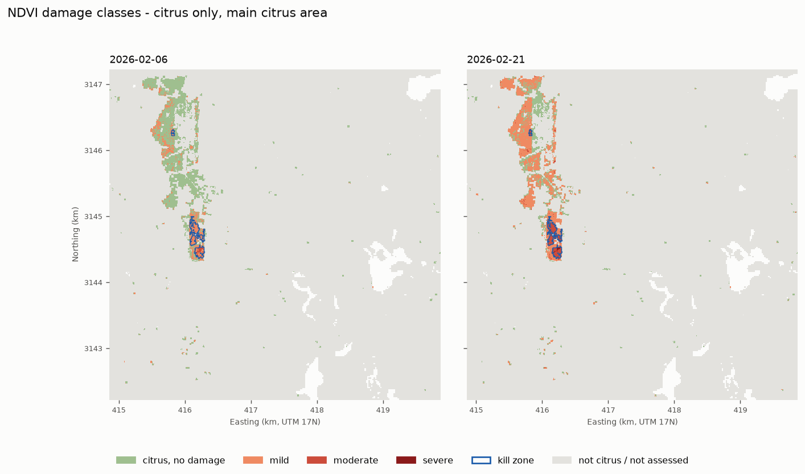
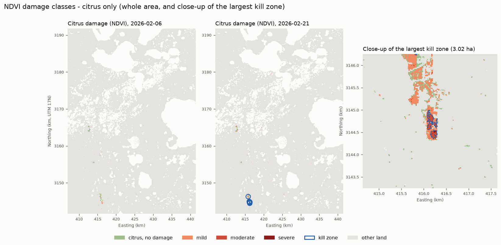
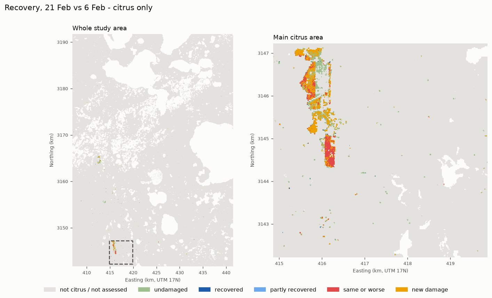
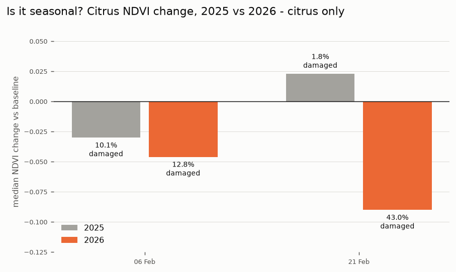
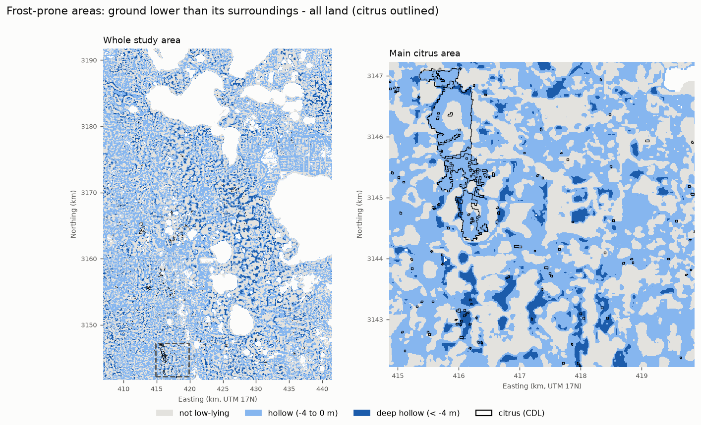
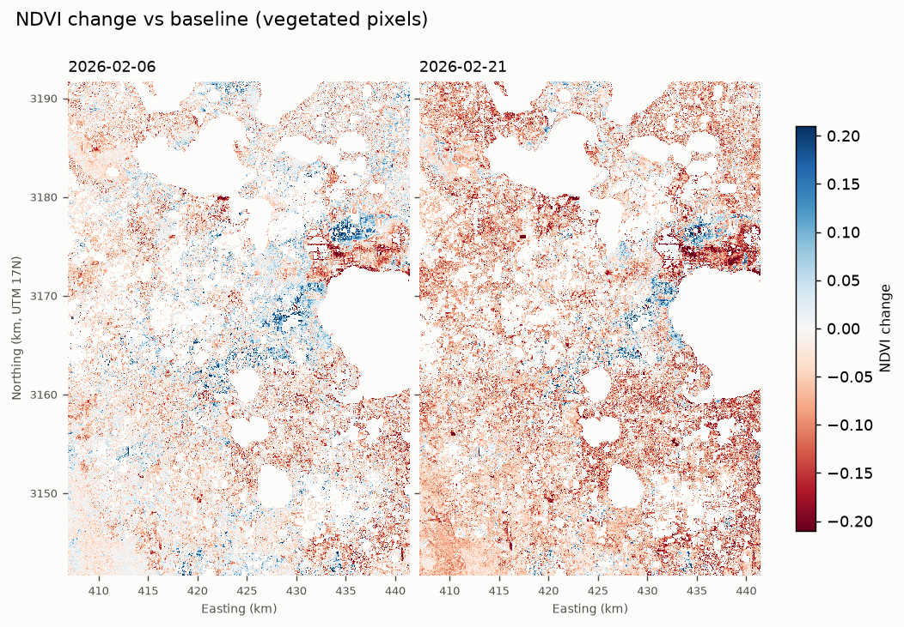

# Citrus freeze damage from Sentinel-2 – Lake County, Florida (Jan–Feb 2026)

A multi-day freeze hit central Florida from 26 January to 2 February 2026. This
repository maps the damage to citrus groves around Clermont (Lake County) with
Sentinel-2 imagery, by comparing vegetation indices after the freeze with a
January baseline. **NDVI change is the damage measure**; four other indices
(EVI, NDRE, NDWI, MCARI) are used as supporting evidence.

One command runs everything: search, download, cloud masking, indices, damage
classes, kill zones, recovery, frost-prone areas, tables and figures.

## Key findings

- **Damaged citrus rose from 12.8% (6 Feb) to 43.0% (21 Feb)**, about nine-tenths of it mild, as freeze-injured leaves dried out and dropped.
- **6 kill zones (6.1 ha)**, all in one grove area south-west of Clermont (around 28.43 N, 81.86 W).
- **Not seasonal:** in 2025 citrus NDVI *rose* slightly by 21 Feb (+0.023); in 2026 it fell by 0.090.
- **Frost pockets:** citrus in ground lower than its surroundings was damaged about twice as often (16.8% vs 7.6% on 6 Feb).

## Objectives

| Objective | Question | Output |
|---|---|---|
| **Insurance claims** | Where are the kill zones within the orchards? | Kill zones: polygons (`kill_zones.gpkg`), table, map |
| **Recovery monitoring** | Is the canopy regrowing, or is the damage persisting? | Recovery classes, 6 Feb vs 21 Feb: raster, table, map |
| **Future planning** | Which ground is frost-prone? | Frost-prone (low-lying) map from the Copernicus DEM, damage rate per class |

## Method



| NDVI change vs baseline | Damage class |
|---|---|
| >= -0.10 | none |
| -0.10 to -0.20 | mild |
| -0.20 to -0.30 | moderate |
| < -0.30 | severe |

**Noise check behind the -0.10 threshold:** between two pre-freeze dates
(27 Jan minus 17 Jan, 4.3 million vegetated pixels) the NDVI difference has
mean -0.007, **standard deviation 0.033** and **1st percentile -0.095**; only
0.8% of pixels fall below -0.10. A drop of 0.10 is therefore well outside normal
date-to-date variation.

| Index | Formula (Sentinel-2 bands) | Sensitive to |
|---|---|---|
| NDVI | (B8 - B4) / (B8 + B4) | greenness |
| EVI | 2.5 (B8 - B4) / (B8 + 6 B4 - 7.5 B2 + 1) | greenness, less saturation |
| NDRE | (B8A - B5) / (B8A + B5) | chlorophyll (red edge) |
| NDWI (Gao) | (B8A - B11) / (B8A + B11) | leaf water content |
| MCARI | ((B5 - B4) - 0.2 (B5 - B3)) x (B5 / B4) | chlorophyll absorption |

## Results (10 m)

### Where the citrus is



*Citrus only: USDA CDL 2025 citrus outlined in black on the true-colour image of 6 Feb.
Most citrus in the study area is one grove block in the south-west (right panel); the
small scattered squares are single CDL pixels, many of them probably misclassified.*

### Damage and kill zones (citrus only)

| Citrus only | |
|---|---|
| Citrus in the area (CDL 2025) | 313.5 ha |
| Citrus assessed (vegetated, cloud-free baseline) | 217.0 ha |
| Damaged citrus (mild or worse), 6 Feb | **12.8%** |
| Damaged citrus (mild or worse), 21 Feb | **43.0%** |
| Moderate or worse, 6 Feb / 21 Feb | 0.5% / 3.9% |
| Severe, 6 Feb / 21 Feb | 0.01 ha / 0.4 ha |
| Kill zones | 6 zones, 6.1 ha |

Damage is mostly mild, and it grew strongly between 6 and 21 February:
freeze-injured leaves often stay green for days to weeks before they dry out
and drop. All six kill zones lie within about 2 km of each other in one grove area
(around 28.43 N, 81.86 W).



*Citrus only: NDVI damage classes in the main citrus area on 6 and 21 Feb, kill zones
outlined in blue. Grey = not citrus, or citrus that could not be assessed.*



*Citrus only: the same damage classes for the whole study area, and a close-up of the
largest kill zone.*

### Recovery, 6 Feb vs 21 Feb (citrus only)

| Class | Meaning | Area | Share |
|---|---|---|---|
| undamaged | not damaged on either date | 121.3 ha | 55.9% |
| recovered | damaged on 6 Feb, not on 21 Feb | 2.4 ha | 1.1% |
| partly recovered | damaged on both dates, NDVI rose by more than 0.05 | 0.1 ha | 0.1% |
| same or worse | damaged on both dates, no rise above 0.05 | 25.2 ha | 11.6% |
| new damage | not damaged on 6 Feb, damaged on 21 Feb | 68.0 ha | 31.3% |

Almost nothing recovered within three weeks. Most damage is *new* on 21 Feb,
which matches the delayed leaf drop after a freeze. "Same or worse" means
persistent damage as of 21 Feb, not confirmed tree loss.



*Citrus only: recovery classes (21 Feb vs 6 Feb), whole area and main citrus area.*

### Is it seasonal? (citrus only)

The same NDVI change, computed in the same way one year earlier (baseline 2, 12, 17
and 27 Jan 2025; same area, masks, thresholds and citrus mask):

| Date | 2025 median change | 2025 damaged | 2026 median change | 2026 damaged |
|---|---|---|---|---|
| 6 Feb | -0.030 | 10.1% | -0.046 | 12.8% |
| 21 Feb | +0.023 | 1.8% | **-0.090** | **43.0%** |



*Citrus only: median NDVI change vs the January baseline in 2025 (grey) and 2026 (orange)
on 6 and 21 Feb; labels give the share of citrus that would count as damaged.*

In 2025 citrus NDVI *rose* slightly by 21 February; in 2026 it fell sharply. The
21 Feb loss is not normal seasonal change. On 6 Feb the two years are closer, so
part of the early signal may be seasonal (late January 2025 also had a cold spell).

### Frost-prone areas

Cold air drains downhill on calm, clear freezing nights and pools in low ground.
The **low-lying index** is each pixel's elevation (Copernicus DEM, 30 m) minus the
mean elevation within 300 m; negative = lower than the surroundings. Citrus damage
on 6 Feb (closest to the freeze) is compared between the classes.

| Citrus only, 6 Feb | Citrus | Damaged |
|---|---|---|
| Hollows (below surroundings, index < 0 m) | 122.3 ha | **16.8%** |
| Not low-lying (index >= 0 m) | 94.7 ha | 7.6% |

| Low-lying index | < -4 m | -4 to -2 m | -2 to 0 m | 0 to 2 m | >= 2 m |
|---|---|---|---|---|---|
| Citrus area | 7.4 ha | 43.5 ha | 71.4 ha | 51.8 ha | 42.9 ha |
| Damaged, 6 Feb | 9.3% | **19.9%** | 15.6% | 8.7% | 6.4% |

Citrus in ground lower than its surroundings was damaged about twice as often.
The deepest class (< -4 m) has too little citrus (7 ha) to say much.



*All land (terrain, not only citrus): hollows and deep hollows from the low-lying index,
with citrus outlined in black. Lakes are left blank.*

### Supporting indices (citrus only)

Median change of citrus pixels vs the baseline. "Change / noise" divides the
21 Feb change by the normal date-to-date variation of that index (robust SD of
the 17 Jan → 27 Jan difference), so the indices can be compared with each other.

| Index | Baseline (median) | Change 6 Feb | Change 21 Feb | Change / noise, 21 Feb |
|---|---|---|---|---|
| **NDVI** | 0.458 | -0.046 | -0.090 | **-3.7** |
| EVI | 0.282 | -0.036 | -0.061 | -2.9 |
| NDRE | 0.310 | -0.034 | -0.073 | -2.6 |
| NDWI | -0.068 | -0.036 | -0.079 | -3.0 |
| MCARI | 0.045 | -0.008 | +0.001 | 0.1 |

NDVI, EVI, NDRE and NDWI all fall, and all fall further by 21 February: the
canopy lost greenness, chlorophyll and leaf water, which is what freeze injury
looks like. NDVI gives the clearest signal relative to its noise. MCARI shows no
response, probably because it is designed for dense canopies: in these open groves
much of each pixel is soil and grass between tree rows, so its values are small
(median 0.045) and dominated by the background.


*Citrus vs all other vegetation: median change of each index vs each pixel's own
baseline, using only pixels clear on all five plotted dates — 5,221 citrus pixels
(52 ha) and 2,541,628 other-vegetation pixels. 4 Jan, 7 Jan and 1 Feb are left out:
with them, less than 20 ha of citrus is clear on every date. Before the freeze both
groups move together; afterwards citrus falls further than other vegetation.*



*All vegetation (baseline NDVI >= 0.3), not only citrus: NDVI change vs the baseline.
Other vegetation also lost greenness after the freeze.*

### All figures

| Figure | Shows |
|---|---|
| `citrus_location.png` | citrus only: CDL outlines on true colour |
| `damage_citrus_main_area.png`, `damage_ndvi_killzones.png` | citrus only: NDVI damage classes, kill zones |
| `recovery_citrus.png` | citrus only: recovery classes |
| `seasonal_check_citrus.png` | citrus only: NDVI change, 2025 vs 2026 |
| `frost_prone.png` | all land: frost-prone classes, citrus outlined |
| `timeseries_indices.png` | citrus vs all other vegetation: change of each index |
| `map_<index>.png` | all vegetation: each index on the baseline, 6 Feb and 21 Feb |
| `change_<index>.png` | all vegetation: change of each index vs the baseline |

## How to run

```bash
python -m venv .venv && source .venv/bin/activate
pip install -r requirements.txt

python run.py --test   # quick 60 m run (~1-2 min, small download)
python run.py          # full 10 m run (~1.5 GB download, ~4.5 GB RAM)
```

All settings (area, dates, thresholds, indices, colours) are in `config.yaml`.
Downloads are cached per band and date in `data/cache/`, so an interrupted run
resumes where it stopped. Results: figures in `figures/`; GeoTIFFs (damage,
recovery, frost-prone classes, low-lying index), kill-zone polygons (GeoPackage)
and CSV tables in `outputs/10m/`.

| File | What it does |
|---|---|
| `run.py` | runs all steps in order |
| `src/data.py` | STAC search, cached download, reflectance, cloud mask |
| `src/indices.py` | the five indices |
| `src/damage.py` | baseline, change, damage and recovery classes, citrus mask, kill zones |
| `src/terrain.py` | Copernicus DEM, low-lying index, frost-prone classes |
| `src/plots.py` | all figures |

## Data sources

- **Sentinel-2 L2A** surface reflectance (Copernicus / ESA), as Cloud-Optimised
  GeoTIFFs from the [Earth Search STAC catalogue](https://earth-search.aws.element84.com/v1)
  (Element 84, AWS Open Data).
- **Copernicus DEM GLO-30** (30 m elevation, ESA / Airbus), from the same Earth Search
  catalogue (collection `cop-dem-glo-30`).
- **USDA NASS Cropland Data Layer 2025** (class 72 citrus), via the
  [CropScape](https://nassgeodata.gmu.edu/CropScape/) API.

## Limitations

- **Clouds and cirrus.** Only 6 Feb and 21 Feb are mostly clear. Many pixels have
  only one or two clear baseline dates, and 9% of the mapped citrus has none.
- **Cold before the baseline dates.** A hard freeze on 16 Jan came before three of the
  five baseline dates (17, 22 and 27 Jan), and 27 Jan is also the morning after the first
  night of the main freeze. If those dates already show some cold damage, the baseline
  is too low and the damage is underestimated. Some damage from storm Ezra
  (30 Dec – 1 Jan) may also be in the baseline. In a test with other baseline dates
  the damage figures moved by up to about 3 percentage points.
- **21 Feb is three weeks after the freeze.** Damaged canopy is not the same as dead
  trees; a spring image (new flush) is needed to separate the two.
- **Seasonal check** uses one prior year only.
- **Citrus mask.** The CDL is a modelled map: some groves are missed or mislabelled,
  and 68 ha of mapped citrus has a baseline NDVI below 0.3 (young, reset or
  abandoned groves) and is not assessed.
- **One main grove block.** Most citrus is in a single grove block, so the hollow vs
  elsewhere comparison is largely a comparison within one area. It is supporting
  evidence that low ground was hit harder, not proof.
- **Frost-prone map.** The 30 m DEM has about 2 m vertical accuracy and does not resolve
  small hollows; lakes moderate local temperatures, which the index does not model. The
  map relates past damage to terrain; it is a planning guide, not a temperature model.
- **BOA offset.** Earth Search's offset flag is not always correct, so the
  reflectance offset is decided from the data for each scene.

## Future improvements

- **Sentinel-1 SAR** to build a cloud-free baseline (radar sees through cloud and cirrus).
- **A spring image** (new flush) to separate dead trees from defoliated trees that regrow.
- **Field or insurance-claims data** to validate the damage classes and to train a supervised
  (machine-learning) classifier.
- **More prior years** for the seasonal check, instead of 2025 only.
- **Soil-adjusted indices** such as OSAVI or the MCARI/OSAVI ratio, which reduce the soil
  background that masks MCARI in open groves.

## References

- WGCU (6 February 2026). *Florida's citrus industry takes another hit after rare multi-day freeze.*
  https://www.wgcu.org/2026-02-06/floridas-citrus-industry-takes-another-hit-after-rare-multi-day-freeze
- Florida Department of Agriculture and Consumer Services (FDACS) (February 2026). *2026 Freeze Report*
  (preliminary estimates of freeze damage to Florida agriculture).
  https://content.govdelivery.com/attachments/FLDAC/2026/02/20/file_attachments/3560341/FINAL%20-%202026%20Freeze%20Report.pdf
